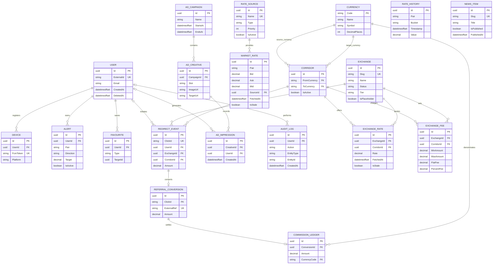

# Remito entity relationship diagram

Currencies are keyed by ISO-style three-letter codes; each corridor references
its source and destination currency. `Favourite.TargetId` is intentionally a
polymorphic key selected by `Favourite.Type`. `RateHistory.Pair` and
`Alert.Pair` use the `AAA/BBB` pair notation. User deletion is soft deletion
through `DeletedAt`; exchange visibility is managed by `Status` rather than
deleting exchange rows.
